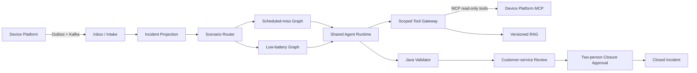

# CardioOps AI

> Evidence-grounded incident investigation for remote cardiac-device operations.

CardioOps AI 是一个面向 ICM/ICD 远程监测场景的 AI 调查与客服协作平台。上游设备平台继续负责设备接入、协议解析和确定性异常检测；CardioOps 通过 Kafka 接收异常事实，使用场景化 Agent 调用只读 MCP 工具收集证据，再由 Java Validator 重算关键业务结论。

本仓库是可公开运行的工程化版本：所有标识和案例均为合成数据，不包含患者身份、原始 ECG、生产地址、内部凭据或第三方系统源码。

## 为什么需要 AI

远程设备问题通常需要人工在设备档案、网关状态、传输批次、计划变更和 SOP 之间反复查询。纯规则适合识别确定事实，但不擅长组织假设、发现缺失证据和生成可读调查摘要。

CardioOps 将两类职责分开：

- 模型负责提出假设、按预算选择只读工具、组织证据和生成调查草稿；
- Java 负责身份范围、工具白名单、恢复判定、引用完整性、审批状态机和幂等约束。

模型输出因此是可审计的 Draft，而不是直接改变案件状态的最终命令。

## 主流程



## 工程亮点

- **场景化 Agent**：按事件类型路由到独立 Graph、Prompt、工具策略和 Validator，共享模型循环、租约、预算与观测运行时。
- **确定性外层图**：LangGraph4j 固化 `prepare → investigate → validate → finalize`，动态 Tool Calling 仅发生在调查节点。
- **MCP 双层治理**：客户端 Tool Gateway 执行 Incident Scope、设备 Profile、预算、租约和证据账本校验；服务端再次验证角色、关联键和设备范围。
- **可靠事件入口**：Transactional Outbox + Kafka + Inbox + 业务键形成传输幂等与业务幂等，失败进入 DLT 并支持受控重放。
- **崩溃恢复**：AgentRun 使用租约和心跳协调多 Worker；Graph Checkpoint 保存节点级状态，租约丢失后旧 Worker 不能继续落库。
- **版本化 RAG**：检索受设备 Profile、知识 revision 和业务时间约束；知识只能用于解释，不能覆盖实时证据。
- **人机闭环**：恢复或无需联系不会自动关案，客服先提交提案，再由另一身份审批；批准前重新核验证据与案件版本。
- **可观测性**：Micrometer Observation 串联 Agent、Graph、MCP 与巡检阶段，可导出 OpenTelemetry Trace 和 Prometheus 指标。

## 事件边界

Kafka 只接收三类确定性异常：

| 事件 | 自动调查 | 处理方式 |
|---|---:|---|
| `SCHEDULED_MISSED` | 是 | 首次调查，按设备周期最多复查 3 次 |
| `LOW_BATTERY` | 是 | 判断低电量是否可能影响近期传输 |
| `TRANSMISSION_EVENTS_INCOMPLETE` | 否 | 直接进入人工复核 |

正常传输不作为异常事件发送。Agent 在首次调查和复查时通过 MCP 查询最新传输证据。

## 模块

```text
cardio-ops-contracts       Kafka 事件契约与兼容性校验
cardio-ops-domain          Incident、AgentRun、Profile、Evidence 等领域模型
cardio-ops-application     用例、端口和事务无关的业务编排
cardio-ops-agent-runtime   场景 Graph、Agent Loop、Tool Gateway、Validator
cardio-ops-infrastructure  Kafka、JDBC、Checkpoint、MCP Client、PGVector
cardio-ops-api             客服案件、复核与审批 API
cardio-ops-worker          消费、Agent 执行、复查和一致性巡检
device-platform-mock       合成数据驱动的只读 MCP Server
device-platform-simulator  三类异常事件与重复投递/批量输入生成器
```

## 快速验证

环境要求：JDK 21、Docker、Python 3。

```bash
cp .env.example .env
docker compose -f deploy/compose.yaml up -d
./mvnw --batch-mode --no-transfer-progress clean verify
python3 -m unittest discover -s device-platform-simulator/tests -v
```

启动 Mock MCP、API、Worker 以及投递合成事件的完整步骤见 [Quick Start](docs/quick-start.md)。默认配置不会连接真实模型或产生模型费用；启用真实 Agent 时必须通过环境变量提供 Chat/Embedding 凭据。

## 文档导航

- [系统架构](docs/architecture.md)
- [业务场景与恢复规则](docs/business-scenarios.md)
- [Agent 与 Validator 设计](docs/agent-design.md)
- [MCP 安全边界](docs/mcp-security.md)
- [可靠性设计](docs/reliability-design.md)
- [人工复核与审批](docs/human-approval.md)
- [评测方法](docs/evaluation.md)
- [隐私与合成数据](docs/privacy-and-synthetic-data.md)
- [代码阅读地图](docs/code-map.md)
- [已知限制与路线图](docs/limitations-and-roadmap.md)

## 评测声明

仓库内的自动化测试验证确定性业务规则、证据引用、安全边界、幂等、租约与数据库迁移。模型准确率、P95 和 Token 成本必须通过脱敏金标集实际运行后填写；本仓库不预置虚构数字。评测口径见 [evaluation.md](docs/evaluation.md)。

## 安全与合规

- Mock 与模拟器只使用合成标识；
- MCP 不暴露患者身份、原始 ECG 或任意时间范围查询；
- 所有凭据通过环境变量注入；
- CI 执行单元测试、Compose 校验和 Git 历史密钥扫描；
- 本项目用于架构演示和工程评审，不构成医疗建议，也不能直接用于临床决策。

