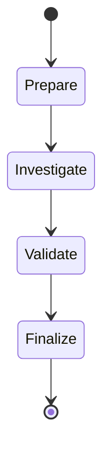

# Agent 与 Validator 设计

## 场景化 Agent

CardioOps 没有使用一个无限能力的通用 Agent。事件路由器把案件交给 `ScheduledMissInvestigationGraph` 或 `LowBatteryInvestigationGraph`。每个场景拥有独立 Prompt、工具集合、Evidence Ledger 和 Validator；`SpringAiToolCallingAgentLoop` 共享模型对话、工具调用轮次和预算控制。

## 确定性图与动态循环

外层图负责可预测的状态迁移与 Checkpoint。`Investigate` 内部允许模型多轮选择只读工具：模型消息提出假设，工具消息返回事实，直到模型生成结构化 Draft 或预算耗尽。

## 为什么 Draft 不是最终结论

模型 Draft 包含根因候选、支持证据、反证、缺失证据和客服摘要。最终结果还必须经过 Java Validator：

- 引用必须存在于本次 Evidence Ledger；
- 工具调用必须符合冻结的 Profile 与白名单；
- `recovered`、低电量影响评估等关键结论重新计算；
- 冲突或缺失证据降级到人工，而不是猜测。

模型调用和每次工具调用前后都检查租约。工具网关绑定单个 AgentRun，模型不能自行传入另一个设备标识，也不能直接获得 HTTP/MCP Client。

