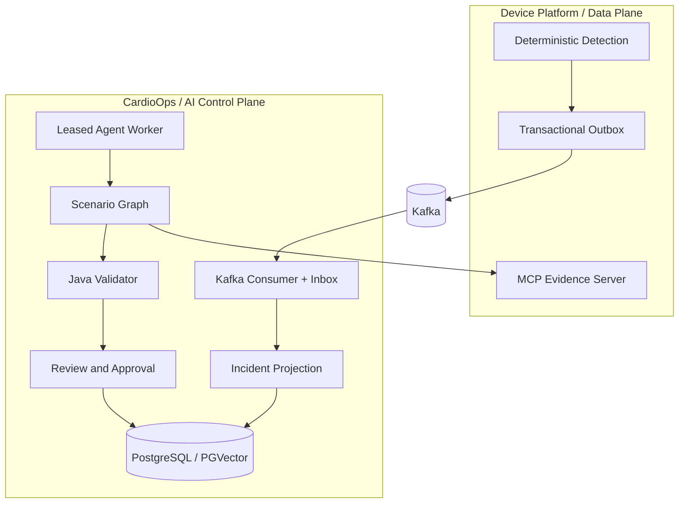

# 系统架构

## 边界

CardioOps 是设备数据面的异步控制面，不参与蓝牙连接、设备协议解析、原始 ECG 保存或设备命令下发。Device Platform 是设备、网关、传输与患者服务事实的唯一来源。



## 运行单元

API 和 Worker 共享领域与基础设施模块，但以不同进程运行：

- API 只提供案件查询、客服复核和主管审批；
- Worker 负责 Kafka、AgentRun、定时复查和一致性巡检；
- Mock MCP 是公开仓库的合成上游，不属于 CardioOps 生产部署。

这种拆分隔离了模型延迟和外部依赖故障，同时避免为了演示拆成大量微服务。

## 依赖方向

```text
api / worker / device-platform-mock
            ↓
agent-runtime / infrastructure
            ↓
application
            ↓
domain

contracts 独立描述跨系统事件，不依赖业务实现。
```

领域层不依赖 Spring、Kafka、JDBC 或模型 SDK；Application 定义端口；Infrastructure 提供适配器；启动模块完成装配。

