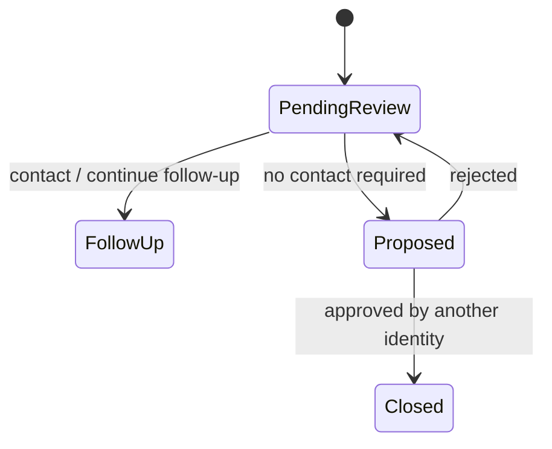

# 人工复核与审批

案件状态与 AgentRun 技术状态分离。模型或工具失败不会把案件伪装成已解决；可恢复的技术失败重试，无法自动判断的业务结果进入人工复核。

关键约束：

- 客服只能提交决定与备注，不能直接关闭案件；
- 关单提案冻结证据引用和 Incident version；
- 提案人与批准人必须是不同身份；
- 批准前重新检查案件版本和关键证据；
- 重复批准具备幂等语义；
- 不自动短信、电话或执行设备写操作。

